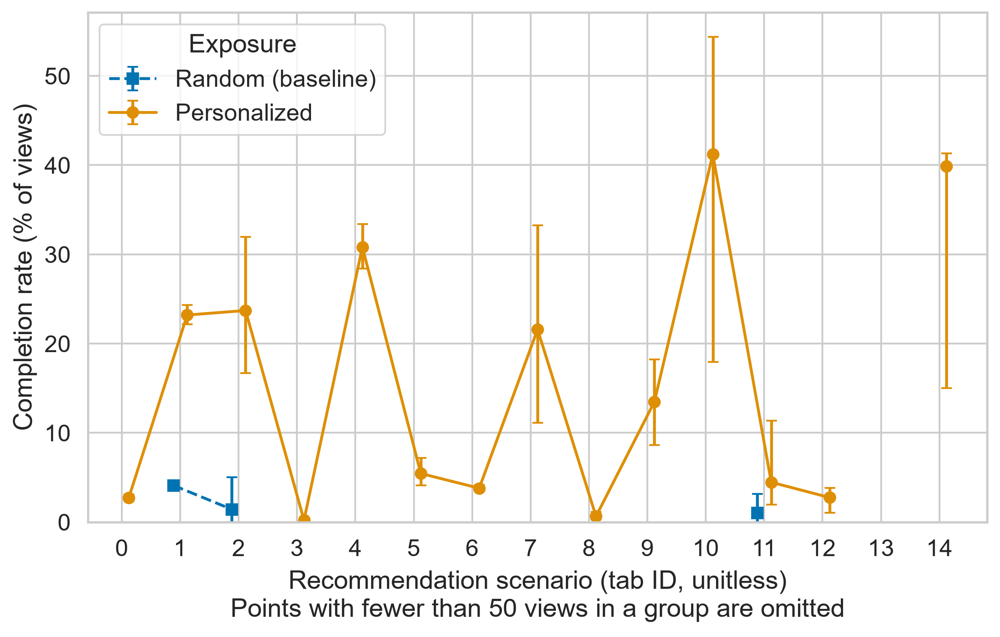
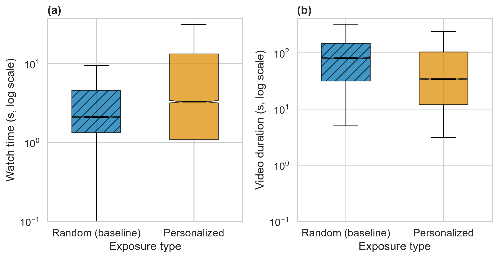

# Personalized vs. Random Exposure and Video Completion Rate (KuaiRand-1K)

**Authors:** Azamat Zhumanov, Diyar Shakenbayev
**Repository:** https://github.com/ShakenbaevD/kuairand-exposure-completion

## Research Question

Does personalized (algorithmic) video exposure increase the probability that a user watches a video to completion, compared with randomly exposed videos, after adjusting for video duration, prior user activity, and platform tab?

## Overview

This is a quantitative, quasi-experimental study on the public KuaiRand-1K dataset. Two exposure groups are compared over 2022-04-22 to 2022-05-08:

- **Personalized** (`is_rand = 0`): `log_standard_4_22_to_5_08_1k.csv`
- **Random** (`is_rand = 1`): `log_random_4_22_to_5_08_1k.csv`

A view is *completed* if `play_time_ms >= 0.9 * duration_ms` (robustness check: threshold 1.0).
Prior user activity is the number of interactions in `log_standard_4_08_to_4_21_1k.csv` (no records = 0).

Model (logistic regression, standard errors clustered by `user_id`):

```
logit(completed) ~ exposure + log(duration_s) + log(1 + activity) + C(tab)
```

where `exposure = 1 - is_rand` (1 = personalized, baseline = random).

- **H0:** OR <= 1 (personalized exposure does not increase completion odds)
- **H1:** OR > 1
- **Primary metric:** adjusted odds ratio of `exposure` with 95% CI. Decision rule: one-sided p < 0.05 and all guardrails pass.
- **Secondary metrics:** difference in completion rate (percentage points), difference in mean watch time (seconds).

## Planned Benchmarks

| ID | Metric | Type | Groups compared | Pass condition |
|----|--------|------|-----------------|----------------|
| B1 | Adjusted OR of exposure (95% CI) | Primary | Personalized vs. random | One-sided p < 0.05 and OR > 1 |
| B2 | Completion rate difference (p.p.) | Secondary | Personalized vs. random | Reported only |
| B3 | Mean watch time difference (s) | Secondary | Personalized vs. random | Reported only |
| G1 | Observations per group | Guardrail | Each group | >= 1000 |
| G2 | Share of missing values | Guardrail | Whole dataset | <= 1% |
| G3 | Model convergence | Guardrail | Logit model | Converges, no perfect separation |
| G4 | Sign robustness | Guardrail | Threshold 0.9 vs. 1.0 | Sign of beta_1 unchanged |

## Repository Structure

```
.
├── configs/
│   ├── config.yaml          # full experiment (KuaiRand-1K in data/raw/)
│   └── config_sample.yaml   # smoke test on data/sample/
├── data/
│   ├── raw/                 # KuaiRand-1K files (NOT tracked by git)
│   ├── sample/              # tiny synthetic sample (tracked)
│   └── processed/           # metrics_summary.csv, data_quality.csv, watch_time_sample.csv
├── docs/
│   ├── methodology_card.md
│   └── domain_model.md      # formal model, loss, metrics, notation (LaTeX)
├── notebooks/
│   └── 01_data_analysis.ipynb
├── outputs/                 # logs and results_*.json (NOT tracked by git)
├── reports/figures/         # fig1_latency_vs_load, fig2_distribution_boxplot (.pdf + .png)
├── src/
│   ├── main.py              # logistic regression, guardrails (Task 2)
│   ├── process_data.py      # cleaning, aggregation, bootstrap CI (Task 3)
│   └── visualize.py         # publication-ready figures (Task 3)
├── Dockerfile
├── requirements.txt         # exact version pins
├── requirements-notebook.txt
├── LICENSE
└── README.md
```

## System Requirements

- Python 3.13.9 (or Docker)
- Packages from `requirements.txt` (all versions pinned exactly)
- For the full run: KuaiRand-1K files in `data/raw/` (several hundred MB, free disk space recommended)

## Quickstart (sample data, ~1 minute)

```bash
git clone https://github.com/ShakenbaevD/kuairand-exposure-completion.git
cd kuairand-exposure-completion
pip install -r requirements.txt && python src/main.py --config configs/config_sample.yaml
```

Results are written to `outputs/` (`results_*.json` and a log file).

> Note: the sample is tiny and synthetic. The model shows perfect separation, so the `model_ok` and `robustness_sign` guardrails are `False` and the decision is "do not reject H0". This is expected and only verifies that the pipeline runs end to end.

### Docker alternative

> Note: the Dockerfile has not been build-tested yet; the pip-based Quickstart above is the verified path.

```bash
docker build -t kuairand-exposure .
docker run --rm -v "$(pwd)/outputs:/app/outputs" kuairand-exposure
```

## Running on the Full Dataset

1. Download KuaiRand-1K from the official dataset site (https://kuairand.com) and unpack it.
2. Copy the three log files (`log_standard_4_08_to_4_21_1k.csv`, `log_standard_4_22_to_5_08_1k.csv`, `log_random_4_22_to_5_08_1k.csv`) into `data/raw/`.
3. Run:

```bash
python src/main.py --config configs/config.yaml
```

Raw data is excluded from git by `.gitignore`.

## Results & Discussion

Baseline = random exposure, Proposed = personalized exposure (same period, 22.04–08.05.2022).
Values are Mean ± SD or Median (p25–p75); CIs are 95% percentile-bootstrap intervals (seed 42, 1000 replicates,
users resampled for completion rate). The table is generated by `python src/process_data.py --update-readme`.

<!-- RESULTS_TABLE_START -->
| Metric | Baseline: Random exposure | Proposed: Personalized exposure |
|---|---|---|
| Views after cleaning (n) | 41,718 | 6,129,856 |
| Users (n) | 1,000 | 1,000 |
| Completion rate, % [95% bootstrap CI] | 4.08 [3.71, 4.46] | 19.35 [18.41, 20.32] |
| Watch time, s: Mean ± SD | 6.85 ± 18.01 | 15.38 ± 35.26 |
| Watch time, s: Median (p25–p75) | 2.10 (1.33–4.62) | 3.21 (1.08–13.27) |
| Watch time p95, s [95% CI] | 27.53 [26.38, 28.72] | 73.81 [72.79, 77.09] |
| Watch time p99, s [95% CI] | 89.64 [85.62, 93.30] | 173.50 [166.63, 178.56] |
| Guardrail: invalid/missing rows, % | 3.04 | 7.92 |

Difference in completion rate (Personalized − Random): **15.27 p.p.** (95% bootstrap CI [14.27, 16.32]).

Adjusted odds ratio of completion (logistic regression, cluster-robust SE): **OR = 6.022**, 95% CI [5.200, 6.974], one-sided p = 2.527e-127.
<!-- RESULTS_TABLE_END -->



**Figure 1.** Completion rate (% of views) per recommendation scenario (tab). Error bars: 95% bootstrap CI.
The file name follows the course template; "load" here is the recommendation scenario because this study has no request-rate benchmark.



**Figure 2.** (a) Watch time and (b) video duration by exposure type, log scale. Box = p25–p75, line = median,
notch = 95% bootstrap CI of the median, whiskers = 1.5·IQR. Vector versions (`.pdf`) are in `reports/figures/`.

**Interpretation and limitations.** The study is observational, so any difference is an adjusted association, not a causal effect.
Random exposure draws from a small video pool, so the groups may differ in video type (see Figure 2b). Completion measures engagement, not satisfaction.
See `docs/methodology_card.md` for all threats to validity.

## Domain Model

The formal problem definition (target variable, logistic model, binary cross-entropy loss, metrics, guardrails, notation table
and a data-flow diagram) is in [`docs/domain_model.md`](docs/domain_model.md).

## Reproducing Task 3

```bash
pip install -r requirements.txt -r requirements-notebook.txt
python src/main.py --config configs/config.yaml          # logistic regression -> outputs/results_full.json
python src/process_data.py --config configs/config.yaml --update-readme   # data/processed/*.csv + README table
python src/visualize.py --config configs/config.yaml     # reports/figures/*.pdf and *.png (300 DPI)
jupyter nbconvert --to notebook --execute --inplace notebooks/01_data_analysis.ipynb
```

The raw logs (about 850 MB) must be in `data/raw/` (see below). Only the small processed files are tracked by git.
`src/visualize.py` needs only `data/processed/`, so the figures can be rebuilt without the raw data.

## Dataset Citation

Gao, C., Li, S., Zhang, Y., Chen, J., Li, B., Lei, W., Jiang, P., He, X. (2022). *KuaiRand: An Unbiased Sequential Recommendation Dataset with Randomly Exposed Videos.* CIKM 2022.

## License

Released under the MIT License (see `LICENSE`).
