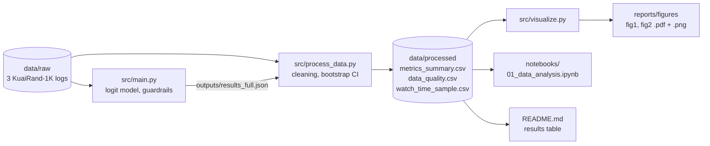

# Domain Model (ML / AI track): formal problem, loss, metrics, notation

This document formalizes the study *Personalized vs. random video exposure and video completion (KuaiRand-1K)*.
It matches `docs/methodology_card.md` and the code in `src/main.py`, `src/process_data.py`, `src/visualize.py`.

## 1. Problem formulation

A **view** $i \in \{1,\dots,N\}$ is one video shown to one user. For every view we observe:

- $u_i$: user id, $t_i \in \{0,\dots,14\}$: recommendation scenario (`tab`);
- $D_i > 0$: video duration (s), $W_i \ge 0$: watch time (s);
- $E_i \in \{0,1\}$: exposure, $E_i = 1$ for *personalized*, $E_i = 0$ for *random* (baseline). In the raw data this is `1 - is_rand`;
- $A_i \ge 0$: user activity, number of the user's interactions in 08–21.04.2022 (computed before the comparison period).

**Target variable (completion):**

$$
y_i = \mathbb{1}\!\left[\, W_i \ge \tau\, D_i \,\right], \qquad \tau = 0.9 \ (\text{robustness check: } \tau = 1.0).
$$

**Feature vector:**

$$
\mathbf{x}_i = \big(\,1,\; E_i,\; \log D_i,\; \log(1 + A_i),\; \mathbb{1}[t_i = 1],\dots,\mathbb{1}[t_i = 14]\,\big)^{\top}.
$$

**Model (logistic regression):**

$$
P(y_i = 1 \mid \mathbf{x}_i) = \sigma(\mathbf{x}_i^{\top}\boldsymbol\beta), \qquad \sigma(z) = \frac{1}{1 + e^{-z}} .
$$

## 2. Loss function

The parameters are estimated by minimizing the binary cross-entropy (the negative log-likelihood):

$$
L(\boldsymbol\beta) \;=\; -\frac{1}{N}\sum_{i=1}^{N}
\Big[\, y_i \,\underbrace{\log \sigma(\mathbf{x}_i^{\top}\boldsymbol\beta)}_{\text{completed view}}
\;+\; (1 - y_i)\,\underbrace{\log\!\big(1 - \sigma(\mathbf{x}_i^{\top}\boldsymbol\beta)\big)}_{\text{not completed}} \Big],
\qquad
\hat{\boldsymbol\beta} = \arg\min_{\boldsymbol\beta} L(\boldsymbol\beta).
$$

Views of one user are correlated, so standard errors use the cluster-robust (sandwich) estimator with clusters $u_i$.
This changes only the uncertainty of $\hat{\boldsymbol\beta}$, not the loss.

## 3. Target metrics

**Primary metric: adjusted odds ratio** of personalized vs. random exposure ($\hat\beta_1$ is the coefficient of $E_i$):

$$
\mathrm{OR} = e^{\hat\beta_1}, \qquad
\mathrm{CI}_{95\%}(\mathrm{OR}) = \Big[e^{\hat\beta_1 - 1.96\,\widehat{\mathrm{se}}},\; e^{\hat\beta_1 + 1.96\,\widehat{\mathrm{se}}}\Big].
$$

**Hypotheses and decision rule:**

$$
H_0:\ \mathrm{OR} \le 1 \qquad\text{vs}\qquad H_1:\ \mathrm{OR} > 1, \qquad
p = 1 - \Phi\!\left(\hat\beta_1 / \widehat{\mathrm{se}}\right).
$$

Reject $H_0$ only if $p < 0.05$ **and** all guardrails (Section 4) pass.

**Secondary metrics.** Completion rate of group $g$ (with $\mathcal{I}_g$ the set of its views) and its difference:

$$
\mathrm{CR}_g = \frac{100}{|\mathcal{I}_g|}\sum_{i \in \mathcal{I}_g} y_i \ \ [\%], \qquad
\Delta\mathrm{CR} = \mathrm{CR}_{\text{pers}} - \mathrm{CR}_{\text{rand}} \ \ [\text{p.p.}].
$$

**Watch-time statistics (descriptive).** For a sample $W_{(1)} \le \dots \le W_{(n)}$ the $q$-th percentile is $p_q$; we report
$\bar W \pm \mathrm{SD}$, the median $p_{50}$ with $(p_{25}\text{–}p_{75})$, and the tail percentiles $p_{95}$ and $p_{99}$ (seconds).

**Speedup-style ratio (optional).** The relative change of completion rate is $S = \mathrm{CR}_{\text{pers}} / \mathrm{CR}_{\text{rand}}$.

**Bootstrap 95% CI** (fixed seed 42, $B = 1000$ replicates):

$$
\mathrm{CI}_{95\%}(\theta) = \Big[\, \hat\theta^{*}_{(0.025)},\; \hat\theta^{*}_{(0.975)} \,\Big],
$$

the 2.5% and 97.5% percentiles of $\hat\theta^{*}_1,\dots,\hat\theta^{*}_B$.

- For $\mathrm{CR}_g$ and $\Delta\mathrm{CR}$ whole **users** are resampled (cluster bootstrap), because views of one user are dependent.
- For $p_{50}, p_{95}, p_{99}$ of watch time, **views** are resampled from a seeded sample of at most 50 000 views per group (the logs are too large to resample 1000 times); point estimates use all views. This ignores the user clustering, so these CIs are somewhat too narrow.

## 4. Guardrail metrics (analog of "error rate" in the course template)

| ID | Guardrail | Definition | Pass condition |
|---|---|---|---|
| G1 | Group size | $\min_g \lvert\mathcal{I}_g\rvert$ after cleaning | $\ge 1000$ |
| G2 | Missing values | share of missing values in each model variable | $\le 1\%$ |
| G3 | Model validity | optimizer converged, no perfect separation | true |
| G4 | Sign robustness | $\operatorname{sign}\hat\beta_1(\tau{=}0.9) = \operatorname{sign}\hat\beta_1(\tau{=}1.0)$ | true |
| G5 | Invalid rows | $100\cdot(n_{\text{missing}} + n_{\text{invalid}})/n_{\text{raw}}$, where invalid means $D \le 0$ or $W < 0$ | reported (`data/processed/data_quality.csv`) |

Invalid rows are counted and reported, not silently dropped, to avoid selection bias.
The 1.5·IQR rule only **flags** outliers (`outlier_share_iqr_pct`); no real view is deleted.

## 5. Notation table

| Symbol | Type | Meaning | Unit / range |
|---|---|---|---|
| $N$ | scalar | number of views after cleaning | count |
| $i$ | index | view index | $1,\dots,N$ |
| $u_i$ | scalar (categorical) | user id of view $i$ (cluster) | id |
| $t_i$ | scalar (categorical) | recommendation scenario (`tab`) | $\{0,\dots,14\}$ |
| $D_i$ | scalar | video duration | s, $> 0$ |
| $W_i$ | scalar | watch time | s, $\ge 0$ |
| $E_i$ | scalar (binary) | exposure: 1 personalized, 0 random (reference) | $\{0,1\}$ |
| $A_i$ | scalar | prior user activity (08–21.04.2022) | count, $\ge 0$ |
| $\tau$ | scalar | completion threshold | 0.9 (robustness 1.0) |
| $y_i$ | scalar (binary) | completion indicator | $\{0,1\}$ |
| $\mathbf{x}_i$ | vector | feature vector (intercept, $E_i$, $\log D_i$, $\log(1+A_i)$, tab dummies) | $\mathbb{R}^{18}$ |
| $\boldsymbol\beta$ | vector | regression coefficients, $\beta_1$ belongs to $E_i$ | — |
| $\sigma(\cdot)$ | function | logistic function | $(0,1)$ |
| $L(\boldsymbol\beta)$ | function | binary cross-entropy loss | $\ge 0$ |
| $\mathrm{OR}$ | scalar | adjusted odds ratio $e^{\hat\beta_1}$ | $> 0$ |
| $\mathcal{I}_g$ | set | views of group $g \in \{\text{pers}, \text{rand}\}$ | — |
| $\mathrm{CR}_g$, $\Delta\mathrm{CR}$ | scalar | completion rate and its difference | %, p.p. |
| $p_q$ | scalar | $q$-th percentile of watch time | s |
| $B$ | scalar | number of bootstrap replicates | 1000 |
| $\Phi$ | function | standard normal CDF | — |

$\mathbf{x}_i$ has 18 entries: intercept, $E_i$, $\log D_i$, $\log(1+A_i)$ and 14 dummies for tabs 1–14 (tab 0 is the reference level).

## 6. Data flow of the pipeline

